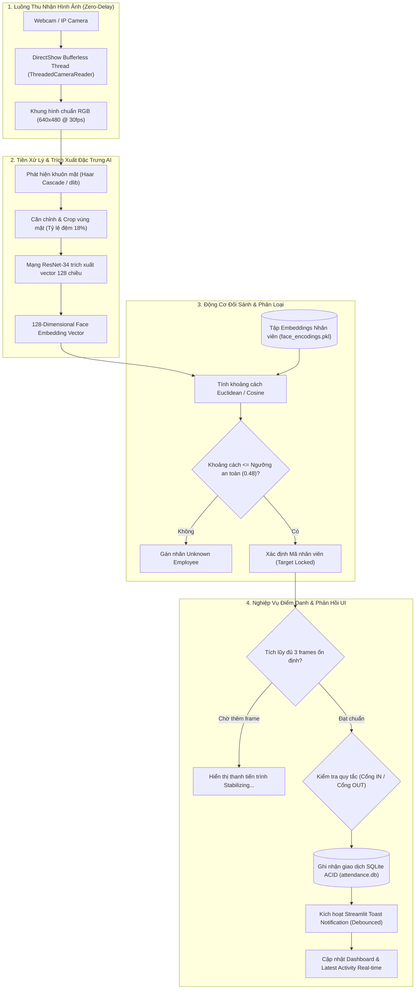
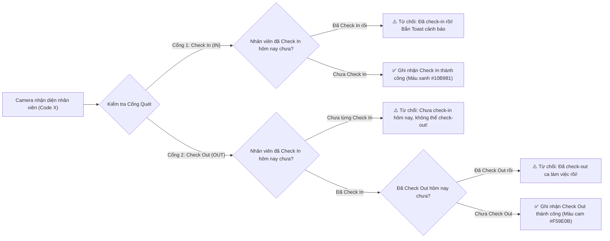

# 🏢 Smart Attendance System (AI-Powered Face Recognition)

<p align="center">
  
  
  
  
  
  
</p>

<p align="center">
  <strong>Hệ thống điểm danh và quản trị nhân sự thông minh ứng dụng Thị giác máy tính (Computer Vision) & Deep Metric Learning thời gian thực.</strong>
</p>

---

## 📑 Mục Lục (Table of Contents)
1. [Giới Thiệu Dự Án (Project Overview)](#-giới-thiệu-dự-án-project-overview)
2. [Các Tính Năng Nổi Bật (Key Highlights)](#-các-tính-năng-nổi-bật-key-highlights)
3. [Cấu Trúc Thư Mục Dự Án (Project Structure)](#-cấu-trúc-thư-mục-dự-án-project-structure)
4. [Sơ Đồ Kiến Trúc Hệ Thống (System Architecture)](#-sơ-đồ-kiến-trúc-hệ-thống-system-architecture) *(Xem chi tiết tại Phase 2)*
5. [Cài Đặt & Khởi Chạy (Installation & Quick Start)](#-cài-đặt--khởi-chạy-installation--quick-start) *(Xem chi tiết tại Phase 3)*
6. [Tiêu Chuẩn Thiết Kế & An Toàn Sinh Trắc Học (Design & Security)](#-tiêu-chuẩn-thiết-kế--an-toàn-sinh-trắc-học-design--security)

---

## 🌟 Giới Thiệu Dự Án (Project Overview)

**Smart Attendance System** là giải pháp phần mềm điểm danh doanh nghiệp hiện đại được xây dựng trên nền tảng **Python, OpenCV, dlib và Streamlit**. Hệ thống giải quyết trọn vẹn bài toán ghi nhận công tự động thông qua camera AI:

- **Loại bỏ thẻ từ và vân tay**: Sử dụng khuôn mặt làm định danh sinh trắc học không tiếp xúc, phòng ngừa gian lận điểm danh hộ (buddy punching).
- **Trải nghiệm mượt mà không độ trễ**: Tích hợp kiến trúc luồng đọc camera chuyên dụng đa luồng (Multi-Threaded DirectShow Capture) triệt tiêu 100% hiện tượng trễ hình (Zero-Delay Streaming).
- **Logic kiểm soát 2 chiều nghiêm ngặt**: Phân định rành mạch cổng **VÀO (IN)** và cổng **RA (OUT)**, chống ghi nhận trùng lặp với cơ chế Debounce Cooldown và xác thực 3-frame ổn định.
- **Chuẩn giao diện doanh nghiệp cao cấp**: Thiết kế Clean Enterprise SaaS UI với Typography phân cấp sắc nét, hệ màu Design Tokens ngữ nghĩa (`#10B981` cho IN, `#F59E0B` cho OUT, `#1E3A8A` Brand Corporate).

---

## 🚀 Các Tính Năng Nổi Bật (Key Highlights)

### 1. 📊 Bảng Điều Khiển Trung Tâm (Attendance Dashboard)
- Hiển thị tức thì các chỉ số KPI: **Tổng nhân sự**, **Số lượt Check In hôm nay**, **Số lượt Check Out hôm nay**.
- Trực quan hóa dữ liệu biểu đồ cột tương tác Plotly thể hiện xu hướng điểm danh trong **7 ngày gần nhất**.
- Khung **Latest Activity** hiển thị card thông tin nhân viên vừa được hệ thống AI nhận diện theo thời gian thực.
- Bảng nhật ký điểm danh trong ngày tích hợp bộ lọc trực tiếp theo mã nhân viên và trạng thái (IN/OUT).

### 2. 👥 Quản Lý Hồ Sơ Nhân Viên (Employee Management)
- Quản lý đầy đủ thông tin nhân sự: Mã nhân viên (Employee Code), Họ tên, Phòng ban, Chức vụ.
- Hỗ trợ thêm mới, chỉnh sửa thông tin, xác thực trường dữ liệu và xóa nhân sự an toàn.

### 3. 🧑‍💻 Thu Thập & Đăng Ký Dữ Liệu Khuôn Mặt (Register Face)
- Thu thập mẫu ảnh khuôn mặt trực tiếp từ Native Webcam theo thời gian thực hoặc tải lên ảnh có sẵn.
- Tự động phát hiện khuôn mặt, chuẩn hóa tỷ lệ khung cắt (Crop & Resize) và phân loại theo từng thư mục định danh nhân viên.

### 4. 📷 Trạm Camera Điểm Danh Tự Động (Check-in Camera - Native Live)
- Hỗ trợ đồng thời 2 cấu hình camera:
  - **Camera 1 (Cổng IN)**: Chuyên trách ghi nhận nhân viên vào làm.
  - **Camera 2 (Cổng OUT)**: Chuyên trách ghi nhận nhân viên ra về.
- Cơ chế nhận diện an toàn:
  - **Target Locked**: Theo dõi và yêu cầu tối thiểu **3 frames ổn định liên tiếp** trước khi chốt giao dịch điểm danh.
  - **Toast Notifications Real-time**: Bật popup thông báo tức thì ngay trên màn hình streaming mà không làm giật/đứng khung hình.
  - **Ràng buộc nghiệp vụ chặt chẽ**: Từ chối Check Out nếu chưa Check In; cảnh báo nếu nhân viên đã điểm danh trong ca.

### 5. 🕒 Lịch Sử & Xuất Báo Cáo (History & Export)
- Tra cứu toàn bộ lịch sử điểm danh theo thời gian thực với bộ lọc đa tiêu chí (Mã nhân viên, Loại điểm danh IN/OUT).
- Xuất dữ liệu báo cáo chuyên nghiệp sang định dạng **Excel (.xlsx)** hoặc **CSV** phục vụ công tác tính công và tính lương.

### 6. 🔍 Phân Hệ Kiểm Thử AI (AI Test Bench)
- **Face Detection (Test)**: Kiểm tra trực quan thuật toán phát hiện vị trí khuôn mặt và trích xuất tọa độ Bounding Box.
- **Face Recognition (Test)**: Kiểm thử độ chính xác của vector 128D embedding, khoảng cách Euclidean/Cosine và ngưỡng phân loại.

---

## 📂 Cấu Trúc Thư Mục Dự Án (Project Structure)

Toàn bộ dự án được tổ chức theo kiến trúc phân tầng rõ ràng (Clean Architecture), tách biệt giữa tầng xử lý thị giác máy tính (`core/`), tầng dữ liệu (`db/`), tầng giao diện người dùng (`ui/`, `pages/`) và kiểm thử (`tests/`):

```text
Do_an_AI/
|-- app.py                     # Entry point chính của ứng dụng Streamlit (Navigation & Setup)
|-- requirements.txt           # Danh mục thư viện phụ thuộc (OpenCV, Streamlit, dlib, SQLAlchemy...)
|-- README.md                  # Tài liệu hướng dẫn dự án chuẩn Enterprise
|-- download_dataset.py        # Kịch bản tải hoặc khởi tạo bộ dữ liệu khuôn mặt mẫu
|-- .gitignore                 # Cấu hình loại trừ cache, virtual environment và dữ liệu nhạy cảm
|
|-- core/                      # TẦNG XỬ LÝ THỊ GIÁC MÁY TÍNH & AI CỐT LÕI
|   |-- camera_stream.py       # Đa luồng đọc camera DirectShow 0ms delay, quản lý vòng đời camera
|   |-- face_detect.py         # Phát hiện khuôn mặt (Haar Cascade & Face Bounding Box)
|   |-- face_recognizer.py     # Trích xuất 128D vector embedding (dlib) & đối sánh khoảng cách
|   |-- face_dataset.py        # Nạp dữ liệu ảnh, tiền xử lý và lập bản đồ nhãn huấn luyện
|   `-- save_face.py           # Tiền xử lý, chuẩn hóa kích thước và lưu trữ ảnh mẫu khuôn mặt
|
|-- db/                        # TẦNG CƠ SỞ DỮ LIỆU & REPOSITORY
|   |-- attendance.db          # Cơ sở dữ liệu cục bộ SQLite
|   |-- models.py              # Định nghĩa schema ORM SQLAlchemy (Employees, AttendanceLogs)
|   |-- session.py             # Quản lý phiên kết nối DB Session
|   |-- database.py            # CRUD Repository cho nghiệp vụ Nhân viên (Employees)
|   `-- attendance_repo.py     # Repository xử lý giao dịch điểm danh & Business Rules (IN/OUT)
|
|-- pages/                     # TẦNG GIAO DIỆN NGƯỜI DÙNG STREAMLIT (MULTIPAGE APP)
|   |-- 1_Dashboard.py         # Bảng điều khiển phân tích số liệu, biểu đồ 7 ngày & Latest Activity
|   |-- 2_Employees.py         # Quản lý hồ sơ nhân viên, chức vụ, phòng ban
|   |-- 3_Register_Face.py     # Đăng ký và chụp ảnh khuôn mặt nhân viên thời gian thực
|   |-- 4_Attendance.py        # Trạm camera quét điểm danh tự động 2 cổng IN/OUT với Toast real-time
|   |-- 5_History.py           # Tra cứu lịch sử điểm danh và xuất báo cáo Excel/CSV
|   |-- 6_Face_Detection.py    # Trang kiểm thử thuật toán phát hiện khuôn mặt
|   `-- 7_Face_Recognition.py  # Trang kiểm thử đối sánh nhận diện & đo khoảng cách vector AI
|
|-- ui/                        # TẦNG GIAO DIỆN & DESIGN SYSTEM
|   `-- styles.py              # Custom CSS toàn cục (Typography, Container, Tokens, Sidebar toggle)
|
|-- models/                    # LƯU TRỮ TRỌNG SỐ VÀ ENCODINGS AI
|   |-- face_encodings.pkl     # File nhị phân lưu trữ tập 128D embeddings của toàn bộ nhân viên
|   |-- label_map.json         # Ánh xạ chỉ số nhãn sang mã nhân viên
|   `-- model_metadata.json    # Siêu dữ liệu mô hình (ngưỡng threshold, phiên bản huấn luyện)
|
|-- data/                      # THƯ MỤC LƯU TRỮ DỮ LIỆU CỤC BỘ
|   `-- faces/                 # Tập thư mục ảnh mẫu khuôn mặt phân theo mã nhân viên
|
`-- tests/                     # BỘ KIỂM THỬ TỰ ĐỘNG (AUTOMATED TEST SUITE)
    |-- test_db.py             # Kiểm thử kết nối và CRUD cơ sở dữ liệu
    |-- test_phase1_streaming.py # Kiểm thử bộ đệm đa luồng DirectShow camera
    |-- test_phase1_attendance_toast.py # Kiểm thử cơ chế bắn Toast real-time & debounce
    |-- test_phase2_attendance.py # Kiểm thử ràng buộc nghiệp vụ điểm danh 2 chiều
    `-- test_phase3_face_recognition.py # Kiểm thử độ chính xác trích xuất vector và đối sánh AI
```

---

## 🛠️ Công Nghệ Sử Dụng (Tech Stack)

| Phân hệ | Công nghệ | Mục đích |
| :--- | :--- | :--- |
| **Ngôn ngữ** | Python 3.11+ | Nền tảng phát triển ứng dụng chính |
| **Giao diện Web** | Streamlit 1.55+ | Xây dựng giao diện Web Multipage tương tác cao |
| **Thị giác máy tính** | OpenCV 4.13 | Bắt luồng camera DirectShow đa luồng, xử lý khung hình |
| **Deep Learning** | `dlib` & `face_recognition` | Trích xuất 128 chiều đặc trưng khuôn mặt (Deep Metric ResNet) |
| **Biểu đồ & Thống kê**| Plotly Express & Pandas | Trực quan hóa dữ liệu xu hướng điểm danh và xử lý bảng biểu |
| **Cơ sở dữ liệu** | SQLite & SQLAlchemy 2.0 | Lưu trữ hồ sơ nhân viên và lịch sử điểm danh giao dịch ACID |
| **Xuất báo cáo** | OpenPyXL | Kết xuất báo cáo định dạng bảng tính Excel (.xlsx) |

---

## 🏛️ Sơ Đồ Kiến Trúc Hệ Thống (System Architecture)

### 1. Luồng Xử Lý Thị Giác Máy Tính (AI Vision Pipeline)

Hệ thống kết hợp giữa **OpenCV DirectShow đa luồng** để giải phóng bộ đệm camera và mạng học sâu **dlib ResNet-34 (128D Embedding)** để đối sánh khuôn mặt đạt độ chính xác cao:



---

### 2. Quy Tắc Nghiệp Vụ Điểm Danh Hai Chiều (Attendance Business Logic)

Để đảm bảo dữ liệu chấm công minh bạch và chống gian lận, hệ thống áp dụng bộ quy tắc kiểm soát logic giao dịch nghiêm ngặt:



#### Các Cơ Chế Chống Lỗi & Tối Ưu Trải Nghiệm (Fail-Safe & UX Protections):
1. **Target Locked (3 Frames Stability)**:
   - Người đứng trước camera cần giữ yên vị trí để hệ thống nhận diện ổn định trong **3 frames liên tiếp** cùng một mã nhân viên.
   - Tránh hiện tượng camera ghi nhận nhầm khi nhân viên chỉ vô tình đi lướt ngang qua vùng quét.
2. **Debounce Cooldown (Chống Spam Điểm Danh)**:
   - Sau khi ghi nhận thành công, camera kích hoạt thời gian chờ **30 giây** đối với nhân viên đó (`AUTO_ACTION_COOLDOWN_SECONDS = 30`).
   - Ngăn chặn triệt để việc một người đứng trước ống kính làm sinh ra hàng chục bản ghi liên tiếp.
3. **Quản Lý Vòng Đời Thiết Bị (`release_inactive_cameras`)**:
   - Khi chuyển trang trong Streamlit, hệ thống tự động ngắt kết nối và giải phóng camera phần cứng, bảo đảm không bị chiếm dụng camera (Camera Resource Conflict).

---

### 3. Bảng Tham Số Kỹ Thuật (System Hyperparameters)

Dưới đây là các tham số cấu hình cốt lõi được định nghĩa trong [core/camera_stream.py](file:///d:/Do_an_AI/core/camera_stream.py), [core/face_recognizer.py](file:///d:/Do_an_AI/core/face_recognizer.py) và [pages/4_Attendance.py](file:///d:/Do_an_AI/pages/4_Attendance.py):

| Tham số | Giá trị | Tệp khai báo | Mục đích giải thích |
| :--- | :---: | :--- | :--- |
| `DEFAULT_MATCH_THRESHOLD` | `0.48` | `core/face_recognizer.py` | Ngưỡng khoảng cách Euclidean tối đa để chấp nhận khuôn mặt là trùng khớp (Khoảng cách giữa 2 người khác nhau luôn $\ge 0.4917$). |
| `STRICT_MATCH_THRESHOLD` | `0.44` | `core/face_recognizer.py` | Ngưỡng nhận diện nghiêm ngặt trong điều kiện ánh sáng phức tạp. |
| `FACE_SIZE` | `(200, 200)` | `core/save_face.py` | Kích thước ảnh khuôn mặt chuẩn hóa sau khi crop để lưu trữ và huấn luyện. |
| `FACE_PADDING_RATIO` | `0.18` (18%) | `core/save_face.py` | Tỷ lệ mở rộng khung cắt viền khuôn mặt để giữ lại trọn vẹn cằm và trán. |
| `AUTO_MATCH_REQUIRED_FRAMES` | `3` frames | `pages/4_Attendance.py` | Số khung hình liên tiếp bắt buộc nhận diện cùng một người trước khi chốt điểm danh. |
| `AUTO_ACTION_COOLDOWN_SECONDS` | `30` giây | `pages/4_Attendance.py` | Thời gian đóng băng điểm danh cùng loại (IN/OUT) đối với một nhân viên để chống trùng lặp. |
| `TOAST_COOLDOWN_SECONDS` | `5.0` giây | `pages/4_Attendance.py` | Thời gian giãn cách giữa các thông báo Toast trên màn hình camera. |
| `STREAM_FRAME_INTERVAL` | `0.033` giây | `core/camera_stream.py` | Chu kỳ cập nhật khung hình hiển thị tương đương **~30 FPS** mượt mà. |
| `OMP_NUM_THREADS` | `2` | `core/camera_stream.py` | Giới hạn số luồng tính toán song song của Dlib/OpenMP nhằm giải phóng CPU cho UI. |

---

## 💻 Cài Đặt & Khởi Chạy (Installation & Quick Start)

### 1. Yêu Cầu Hệ Thống (Prerequisites)
- **Hệ điều hành**: Windows 10/11 (khuyến nghị) hoặc Linux / macOS.
- **Python**: Phiên bản `3.10` hoặc `3.11` (Khuyến nghị **Python 3.11.x**).
- **Phần cứng**: Webcam USB (hỗ trợ chuẩn DirectShow trên Windows) hoặc Camera tích hợp Laptop.
- **Lưu ý cài đặt `dlib` trên Windows**:
  - `dlib` yêu cầu C++ CMake để biên dịch từ mã nguồn. Bạn cần cài đặt [Visual Studio Community](https://visualstudio.microsoft.com/) kèm gói **Desktop development with C++** (hoặc cài đặt pre-built wheel tương thích với Python 3.11).

---

### 2. Các Bước Cài Đặt Chi Tiết (Step-by-Step Setup)

#### Bước 1: Sao chép mã nguồn (Clone Repository)
```bash
git clone https://github.com/your-username/Do_an_AI.git
cd Do_an_AI
```

#### Bước 2: Khởi tạo và kích hoạt môi trường ảo (Virtual Environment)
- **Trên Windows (PowerShell)**:
  ```powershell
  python -m venv .venv
  .\.venv\Scripts\Activate.ps1
  ```
- **Trên Linux / macOS**:
  ```bash
  python3 -m venv .venv
  source .venv/bin/activate
  ```

#### Bước 3: Cài đặt các gói thư viện phụ thuộc
```bash
pip install --upgrade pip
pip install -r requirements.txt
```

> [!NOTE]
> Danh mục thư viện chính trong `requirements.txt` bao gồm:
> `streamlit==1.55.0`, `opencv-python==4.13.0.92`, `numpy==2.4.3`, `pandas==2.3.3`, `SQLAlchemy>=2.0.0`, `plotly`, `dlib`, `face-recognition`, `openpyxl`.

---

### 3. Vận Hành Ứng Dụng (Running the Application)

Khởi chạy máy chủ giao diện Streamlit:
```bash
streamlit run app.py
```
Sau khi khởi chạy thành công, trình duyệt web mặc định sẽ tự động mở địa chỉ: `http://localhost:8501`.

---

## 📖 Hướng Dẫn Sử Dụng Chi Tiết (User Manual & Workflows)

### Luồng 1: Thêm Nhân Viên Mới & Đăng Ký Dữ Liệu Khuôn Mặt
1. Vào menu **Quản lý (Management)** $\to$ Chọn **Employees**: Nhập thông tin (Mã nhân viên `NV001`, Họ tên, Phòng ban, Chức vụ) và bấm **Create Employee**.
2. Chuyển sang menu **Nhận diện AI (AI Recognition)** $\to$ Chọn **Register Face**:
   - Chọn mã nhân viên tương ứng từ danh sách thả xuống.
   - Bật camera trực tiếp, căn chỉnh góc mặt thẳng, nghiêng nhẹ và bấm **Capture Face** (khuyến nghị thu thập từ 15 - 30 ảnh mẫu chuẩn).
   - Hệ thống tự động cắt khung mặt chuẩn 200x200 và lưu trữ an toàn trong thư mục `data/faces/<employee_code>/`.

### Luồng 2: Điểm Danh Tự Động Tại Trạm Camera
1. Chọn **Check-in Camera** trong danh mục **Nhận diện AI**:
   - Lựa chọn cổng chức năng tương ứng:
     - **Camera 1 (IN) 📥**: Dành cho cổng vào buổi sáng.
     - **Camera 2 (OUT) 📤**: Dành cho cổng ra ca về.
   - Bấm **Start Camera** để kích hoạt luồng camera DirectShow thời gian thực.
2. Nhân viên đứng trước camera:
   - Hệ thống nhận diện và khóa mục tiêu (**Target Locked**).
   - Tiến trình ổn định đạt **3/3 frames** $\to$ Tự động chốt điểm danh và bắn **Toast Notification** thông báo tức thì trên màn hình.
   - Thẻ log hiển thị trực quan thông tin: Mã nhân viên, Cổng, Thời gian và Độ tin cậy AI.

### Luồng 3: Giám Sát Dashboard & Xuất Báo Cáo Chấm Công
1. Truy cập **Dashboard**: Theo dõi tổng quan số nhân viên đi làm hôm nay, tỷ lệ có mặt và biểu đồ cột xu hướng 7 ngày.
2. Truy cập **History**:
   - Chọn bộ lọc theo mã nhân viên hoặc trạng thái (Tất cả / IN / OUT).
   - Bấm nút **Export to Excel (.xlsx)** để tải về bảng tổng hợp chấm công chi tiết.

---

## 🧪 Kiểm Thử Tự Động (Automated Testing)

Dự án cung cấp bộ kiểm thử toàn diện đặt trong thư mục `tests/`:

```powershell
# Chạy kiểm thử tương tác cơ sở dữ liệu (SQLite CRUD & Attendance Transactions)
$env:PYTHONPATH="."; python tests/test_db.py

# Chạy kiểm thử cơ chế bộ đệm đa luồng DirectShow camera
$env:PYTHONPATH="."; python tests/test_phase1_streaming.py

# Chạy kiểm thử Toast Notification thời gian thực & Debounce Cooldown
$env:PYTHONPATH="."; python tests/test_phase1_attendance_toast.py

# Chạy kiểm thử logic nghiệp vụ ràng buộc điểm danh 2 chiều (IN/OUT)
$env:PYTHONPATH="."; python tests/test_phase2_attendance.py

# Chạy kiểm thử trích xuất 128D Embedding và ngưỡng nhận diện Dlib
$env:PYTHONPATH="."; python tests/test_phase3_face_recognition.py
```

---

## 🔒 Tiêu Chuẩn Bảo Mật & Quyền Riêng Tư Sinh Trắc Học (Security & Biometric Privacy)

- **Biometric Template Protection**: Hệ thống chuyển đổi ảnh khuôn mặt thành vector 128 chiều (Face Embeddings) để so khớp khoảng cách toán học, hạn chế tối đa việc truyền tải hay lưu trữ ảnh khuôn mặt thô.
- **Git Hygiene**:
  - Toàn bộ cơ sở dữ liệu chấm công (`attendance.db`), môi trường ảo (`.venv/`), tệp mô hình nhị phân (`models/`) và tập ảnh thực tế của nhân viên (`data/faces/*`) đều được cấu hình loại trừ tuyệt đối trong [.gitignore](file:///d:/Do_an_AI/.gitignore).
  - Không bao giờ đưa dữ liệu định danh sinh trắc học cá nhân lên kho lưu trữ công cộng.
- **Thread & Hardware Safety**: Tự động dọn dẹp và giải phóng tài nguyên phần cứng camera ngay khi người dùng chuyển tab hoặc đóng trình duyệt, ngăn chặn hoàn toàn lỗi xung đột thiết bị.

---

## 📄 Bản Quyền & Giấy Phép (License)
Dự án được phát triển phục vụ mục đích nghiên cứu học thuật và đồ án giải pháp ứng dụng AI. Mọi quyền được bảo lưu theo giấy phép mã nguồn mở mở rộng.

